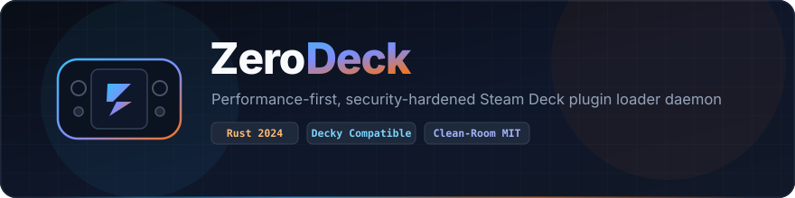
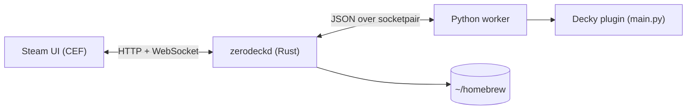

<div align="center">

<picture>
  <source media="(prefers-color-scheme: dark)" srcset="docs/assets/banner-dark.svg" />
  <source media="(prefers-color-scheme: light)" srcset="docs/assets/banner-light.svg" />
  
</picture>

<p>
  A clean-room, MIT-licensed rewrite of <a href="https://github.com/SteamDeckHomebrew/decky-loader">decky-loader</a> in Rust,<br />
  built to run your existing Decky plugins — faster and safer.
</p>

[](https://github.com/ygorsimoes/zerodeck/actions/workflows/ci.yml)
[](https://github.com/ygorsimoes/zerodeck/releases)
[](rust-toolchain.toml)
[](LICENSE)

[Why](#why-zerodeck) · [Status](#status) · [Try it](#try-it) · [How it works](#how-it-works) · [Contributing](#contributing)

</div>

> [!WARNING]
> **ZeroDeck is in early development and does not replace Decky Loader yet.** The daemon runs and
> discovers plugins, but it can't load them into Steam. Keep using Decky Loader on your Deck for
> now. See [Status](#status) for what works today.

## Why ZeroDeck?

[Decky Loader](https://github.com/SteamDeckHomebrew/decky-loader) is what lets a Steam Deck run
plugins in the Quick Access Menu. It works, but it's a single Python process bundled with
PyInstaller, running in the background on a handheld all day.

ZeroDeck rebuilds that loader as a native Rust daemon while keeping the same contracts plugins
already rely on (`plugin.json`, `@decky/api`, `@decky/ui`, `main.py` and the `decky` module). The
goal is simple: **existing plugins keep working, unmodified**, and the loader underneath gets
lighter and harder to break.

| | Decky Loader | ZeroDeck |
|---|---|---|
| **Runtime** | Python + PyInstaller | Native Rust binary (`tokio` + `axum`) |
| **Plugin backends** | Python processes over `/tmp` sockets | Isolated workers over inherited `socketpair()` FDs |
| **Settings** | Rewritten in place | Atomic writes — no corrupted JSON on power loss |
| **Plugin installs** | Extracted as-is | Zip-Slip checks + mandatory SHA-256 verification |
| **Plugin file routes** | No path canonicalization | Every path canonicalized and jailed |
| **Privileges** | Coarse | Plugins drop to the `deck` user unless they declare `"root"` |
| **License** | GPL-2.0 | MIT |

Parts of the ZeroDeck column are still being built; [Status](#status) shows where things stand.
ZeroDeck is written from public protocols and plugin contracts only. No Decky Loader code is
copied, and [`cargo-deny`](deny.toml) blocks copyleft dependencies in CI.

## Status

| Phase | Scope | |
|---|---|---|
| **1. Foundation** | Workspace, wire protocol types, path jail, atomic settings, safe archive extraction, plugin discovery, HTTP/WebSocket server skeleton, CI and releases | In progress |
| **2. Plugin host** | Process supervisor and Python worker, tested against real Decky plugins | Planned |
| **3. Full server** | `FULL_SYNC`, `/fetch` proxy, plugin static and data routes, file picker, store installer | Planned |
| **4. Steam integration** | CEF injection, crash recovery, Quick Access Menu UI | Planned |

**What works today:** `zerodeckd` starts, validates its config, discovers plugins in
`~/homebrew/plugins`, and answers `ping` and `get_plugins` over HTTP and WebSocket with token
auth and Steam-only CORS.

## Try it

For now, ZeroDeck is meant for development and testing on a desktop, not on a Steam Deck.

```bash
git clone https://github.com/ygorsimoes/zerodeck.git && cd zerodeck
pnpm install --frozen-lockfile
just build-frontend
cargo run --bin zerodeckd          # listens on 127.0.0.1:1337
```

Or run the hardened container (read-only filesystem, all capabilities dropped):

```bash
just docker-up
curl http://127.0.0.1:1337/healthz   # {"status":"ok"}
```

You'll need Rust (the version is pinned in [`rust-toolchain.toml`](rust-toolchain.toml)),
[`just`](https://github.com/casey/just), Node 26+ and pnpm. See
[`CONTRIBUTING.md`](CONTRIBUTING.md#-development-setup) for the full setup.

Each [release](https://github.com/ygorsimoes/zerodeck/releases) also ships a `linux-x86_64`
tarball with checksums and a container image at `ghcr.io/ygorsimoes/zerodeck`.

<details>
<summary><strong>Configuration</strong></summary>
<br />

| Flag | Environment variable | Default | Description |
|---|---|---|---|
| `--host` | `SERVER_HOST` | `127.0.0.1` | Address to bind the HTTP/WebSocket server to |
| `--port` | `SERVER_PORT` | `1337` | Port to listen on |
| `--check-config` | | | Validate paths, settings and plugin manifests, then exit |
| `--healthcheck` | | | Probe `/healthz` on a running daemon and exit `0` or `1` |
| | `UNPRIVILEGED_PATH` | `~/homebrew` | Root for `settings/`, `data/` and `logs/` |
| | `PRIVILEGED_PATH` | `UNPRIVILEGED_PATH` | Root for `plugins/` and `services/` |
| | `RUST_LOG` | `info` | Log filter, e.g. `zerodeck_server=debug` |

</details>

## How it works



`zerodeckd` talks to Steam's UI over the same HTTP and WebSocket protocol Decky uses, and runs
each plugin's Python backend in its own worker process with reduced privileges. The full protocol
(WebSocket frames, IPC messages, manifests and environment variables) is documented in
[`docs/architecture/wire-protocol.md`](docs/architecture/wire-protocol.md).

<details>
<summary><strong>Repository layout</strong></summary>
<br />

| Path | What it does |
|---|---|
| [`crates/zerodeckd`](crates/zerodeckd) | The daemon binary: CLI, logging, graceful shutdown |
| [`crates/zerodeck-server`](crates/zerodeck-server) | HTTP/WebSocket server, auth token, CORS, `/healthz` |
| [`crates/zerodeck-core`](crates/zerodeck-core) | Settings, plugin discovery, archive extraction and verification |
| [`crates/zerodeck-plugin-host`](crates/zerodeck-plugin-host) | Plugin runtime trait and Python worker supervisor |
| [`crates/zerodeck-cef`](crates/zerodeck-cef) | Chrome DevTools Protocol client for the Steam UI |
| [`crates/zerodeck-platform`](crates/zerodeck-platform) | Paths, `SafePath` jail, atomic writes, privilege dropping |
| [`crates/zerodeck-protocol`](crates/zerodeck-protocol) | Wire and IPC message types, manifest schemas |
| [`hosts/python`](hosts/python) | `zerodeck-py-host`, the stdlib-only Python plugin worker |
| [`frontend`](frontend) | `@zerodeck/frontend`, the TypeScript bundle injected into Steam |
| [`deploy/systemd`](deploy/systemd) | `zerodeck.service` unit template |

</details>

## Contributing

Contributions are welcome. Read [`CONTRIBUTING.md`](CONTRIBUTING.md) for setup, commit
conventions and the clean-room rules, then make sure everything passes before opening a PR:

```bash
just check
```

Found a vulnerability? Please report it privately as described in [`SECURITY.md`](SECURITY.md).
Everyone taking part is expected to follow the [Code of Conduct](CODE_OF_CONDUCT.md). AI coding
agents should also read [`AGENTS.md`](AGENTS.md).

## License

ZeroDeck is released under the [MIT License](LICENSE). It is not affiliated with Valve or the
Decky Loader project.
