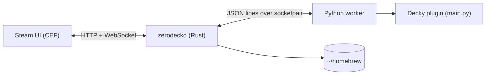

<div align="center">

<picture>
  <source media="(prefers-color-scheme: dark)" srcset="docs/assets/banner-dark.svg" />
  <source media="(prefers-color-scheme: light)" srcset="docs/assets/banner-light.svg" />
  
</picture>

<br />
<br />

**ZeroDeck is a native, Rust-powered plugin loader for the Steam Deck,<br />built to run the Decky plugins you already use, on a lighter and safer core.**

[](https://github.com/ygorsimoes/zerodeck/actions/workflows/ci.yml)
[](rust-toolchain.toml)
[](LICENSE)
[](#roadmap)

[Why](#why-zerodeck) · [Performance](#performance) · [Quick start](#quick-start) · [Steam Deck](#on-steam-deck) · [How it works](#how-it-works) · [Roadmap](#roadmap) · [Contributing](#contributing) · [FAQ](#faq)

</div>

> [!IMPORTANT]
> **ZeroDeck is pre-alpha.** The daemon runs on Linux and macOS today and already uses Decky's
> wire format, but it can't load plugins into Steam yet. That lands in
> [Phase 4](#roadmap). Until then, keep Decky Loader on your Deck.

## Why ZeroDeck

[Decky Loader](https://github.com/SteamDeckHomebrew/decky-loader) built the Steam Deck plugin
ecosystem, and every plugin author and user owes it a lot. ZeroDeck is the next step: the same
plugin contracts, rebuilt from scratch as a native daemon.

- **Native.** A single Rust binary on `tokio` and `axum`. No bundled interpreter in the core.
- **Fast.** Ready to serve in milliseconds, idling at a few megabytes of RAM. [See the numbers](#performance).
- **Compatible.** Targets the contracts plugins already use (`plugin.json`, `package.json`,
  `@decky/api`, `@decky/ui`, `main.py` and the `decky` module), so existing plugins run unmodified.
- **Hardened by default.** Path jails, atomic writes, verified downloads and per-plugin isolation
  are part of the design, not add-ons.
- **MIT, clean-room.** Written only from public protocols and plugin contracts. No Decky Loader code
  is copied, and [`cargo-deny`](deny.toml) blocks copyleft dependencies in CI.

| Capability | Status |
|---|:---:|
| HTTP + WebSocket server using Decky's message format, with an ephemeral auth token | ✅ |
| CORS locked to Steam's UI origin (`https://steamloopback.host`) | ✅ |
| Plugin discovery from `plugin.json` / `package.json` (legacy and ES module plugins) | ✅ |
| `SafePath` jail: canonicalized paths that can't escape their root, symlinks included | ✅ |
| Atomic settings writes (temp file + `fsync` + rename): no corrupted JSON on power loss | ✅ |
| Zip-Slip-safe extraction and fail-closed SHA-256 verification for downloads | ✅ |
| Python worker with the `decky` / `decky_plugin` module surface | ✅ |
| Supervised plugin processes with restart and backoff | 🚧 |
| Private plugin IPC over inherited `socketpair()` FDs (no `/tmp` sockets) | 🚧 |
| Plugins drop to the `deck` user unless they declare `"root"` | 🚧 |
| Plugin static, asset and data routes behind the path jail | 🚧 |
| Injection into Steam's UI and the Quick Access Menu | 🚧 |

✅ shipped and tested · 🚧 in progress (see [Roadmap](#roadmap))

## Performance

| Metric | `zerodeckd` |
|---|---|
| Release binary | **8.4 MiB** |
| Time from launch to first `/healthz` reply | **~13 ms** |
| Memory at idle (RSS) | **~8 MB** |

Measured on an Apple M4 (macOS, arm64) with a release build and an empty plugin directory;
median of five runs. Steam Deck numbers and a side-by-side with Decky Loader on the same device
are coming with [Phase 4](#roadmap).

Reproduce it yourself:

```bash
cargo build --release
ls -lh target/release/zerodeckd
time (./target/release/zerodeckd & until curl -sf http://127.0.0.1:1337/healthz; do :; done)
ps -o rss= -p "$(pgrep -n zerodeckd)"   # KiB
```

## Quick start

ZeroDeck runs on any Linux or macOS machine today. Pick whichever path suits you.

### With Docker

The fastest way to try it. Runs the hardened container (read-only filesystem, all capabilities
dropped, unprivileged user).

```bash
git clone https://github.com/ygorsimoes/zerodeck.git
cd zerodeck
docker compose up -d --build
curl http://127.0.0.1:1337/healthz      # {"status":"ok"}
```

- **Update:** `git pull && docker compose up -d --build`
- **Stop:** `docker compose down`

Plugins go in `.dev-homebrew/plugins/` next to the repository.

### From source

You need Rust (the toolchain in [`rust-toolchain.toml`](rust-toolchain.toml) installs itself
through `rustup`).

```bash
git clone https://github.com/ygorsimoes/zerodeck.git
cd zerodeck
cargo run --release --bin zerodeckd     # listens on 127.0.0.1:1337
```

- **Update:** `git pull && cargo build --release`

### See it discover a plugin

```bash
mkdir -p ~/zerodeck-test/plugins/hello
echo '{"name": "Hello", "author": "you"}' > ~/zerodeck-test/plugins/hello/plugin.json
UNPRIVILEGED_PATH=~/zerodeck-test cargo run --release --bin zerodeckd
```

In another terminal:

```bash
TOKEN=$(curl -s http://127.0.0.1:1337/auth/token)
curl -s -X POST -H "X-Decky-Auth: $TOKEN" http://127.0.0.1:1337/methods/get_plugins
# {"result":["Hello"],"success":true}
```

### From a release

Starting with the first release, every
[GitHub release](https://github.com/ygorsimoes/zerodeck/releases) ships a `linux-x86_64` tarball
(binary, Python worker, frontend bundle and systemd unit) with `SHA256SUMS.txt`, plus a container
image at `ghcr.io/ygorsimoes/zerodeck`. Both carry signed build-provenance attestations, and the
image also ships an SBOM. Verify them with the GitHub CLI:

```bash
gh attestation verify zerodeck-v*-linux-x86_64.tar.gz --repo ygorsimoes/zerodeck
```

<details>
<summary><strong>Configuration</strong></summary>
<br />

| Flag | Environment variable | Default | Description |
|---|---|---|---|
| `--host` | `SERVER_HOST` | `127.0.0.1` | Address to bind the HTTP/WebSocket server to |
| `--port` | `SERVER_PORT` | `1337` | Port to listen on |
| `--check-config` | | | Validate paths, settings and plugin manifests, then exit |
| `--healthcheck` | | | Probe `/healthz` on a running daemon and exit `0` or `1` |
| | `UNPRIVILEGED_PATH` | `~/homebrew` | Root for `settings/`, `data/` and `logs/` |
| | `PRIVILEGED_PATH` | `UNPRIVILEGED_PATH` | Root for `plugins/` and `services/` |
| | `RUST_LOG` | `info` | Log filter, e.g. `zerodeck_server=debug` |

</details>

## On Steam Deck

> [!NOTE]
> 🚧 **Coming in [Phase 4](#roadmap).** This is how it will work. None of it is available yet.

- **Install:** one command in Desktop Mode downloads a SHA-256-verified release and installs
  `zerodeckd` as a systemd service that uses your existing `~/homebrew/plugins`.
- **Update:** the same command fetches and verifies the latest release, then restarts the service.
- **Uninstall:** one command removes the service and binary and leaves your plugins and settings
  untouched.

Want it sooner? [Help build it](#contributing).

## How it works



`zerodeckd` talks to Steam's UI over the same HTTP and WebSocket protocol Decky plugins expect,
and runs each plugin's Python backend in its own worker process. The full protocol (WebSocket
frames, IPC messages, manifests and environment variables) is documented in
[`docs/architecture/wire-protocol.md`](docs/architecture/wire-protocol.md).

<details>
<summary><strong>Repository layout</strong></summary>
<br />

| Path | What it does |
|---|---|
| [`crates/zerodeckd`](crates/zerodeckd) | The daemon binary: CLI, logging, graceful shutdown |
| [`crates/zerodeck-server`](crates/zerodeck-server) | HTTP/WebSocket server, auth token, CORS, `/healthz` |
| [`crates/zerodeck-core`](crates/zerodeck-core) | Settings, plugin discovery, archive extraction and verification |
| [`crates/zerodeck-plugin-host`](crates/zerodeck-plugin-host) | Plugin runtime trait and Python worker launcher |
| [`crates/zerodeck-cef`](crates/zerodeck-cef) | Chrome DevTools Protocol client for Steam's UI |
| [`crates/zerodeck-platform`](crates/zerodeck-platform) | Paths, `SafePath` jail, atomic writes, process identity |
| [`crates/zerodeck-protocol`](crates/zerodeck-protocol) | Wire and IPC message types, manifest schemas |
| [`hosts/python`](hosts/python) | `zerodeck-py-host`, the stdlib-only Python plugin worker |
| [`frontend`](frontend) | `@zerodeck/frontend`, the TypeScript bundle injected into Steam |
| [`deploy/systemd`](deploy/systemd) | `zerodeck.service` unit template |

</details>

## Roadmap

- [ ] **Phase 1 · Foundation** (in progress): workspace, wire protocol types, path jail, atomic
  settings, safe archive extraction, plugin discovery, HTTP/WebSocket server, CI and releases
- [ ] **Phase 2 · Plugin host:** process supervisor and Python worker, tested against real Decky
  plugins
- [ ] **Phase 3 · Full server:** `FULL_SYNC`, `/fetch` proxy, plugin static and data routes, file
  picker, store installer
- [ ] **Phase 4 · Steam integration:** CEF injection, crash recovery, Quick Access Menu UI,
  one-command install and update on Steam Deck

## Contributing

ZeroDeck is early, which means the architecture is still open to good ideas and most of the
interesting work is still ahead. Rust, Python and TypeScript are all welcome.

1. Read [`CONTRIBUTING.md`](CONTRIBUTING.md) for setup, commit conventions and the clean-room rules.
2. Pick something from
   [`good first issue`](https://github.com/ygorsimoes/zerodeck/issues?q=is%3Aissue+is%3Aopen+label%3A%22good+first+issue%22)
   or a 🚧 row in the table above.
3. Make sure everything passes before opening a pull request:

```bash
just check
```

Found a vulnerability? Report it privately as described in [`SECURITY.md`](SECURITY.md). Everyone
taking part is expected to follow the [Code of Conduct](CODE_OF_CONDUCT.md). AI coding agents
should also read [`AGENTS.md`](AGENTS.md).

## FAQ

<details>
<summary><strong>Will my Decky plugins work?</strong></summary>
<br />

That's the goal: existing plugins, unmodified. ZeroDeck already discovers and reads them, but it
can't run them inside Steam until [Phase 4](#roadmap).

</details>

<details>
<summary><strong>Can I run ZeroDeck alongside Decky Loader?</strong></summary>
<br />

Not on the same port: both listen on `127.0.0.1:1337`. For testing, run ZeroDeck on a desktop or
pass `--port` to pick another one.

</details>

<details>
<summary><strong>Why rewrite it instead of contributing to Decky Loader?</strong></summary>
<br />

Moving the core to a native language, changing the process model and relicensing under MIT are
foundational changes, not patches. ZeroDeck keeps the plugin contracts so the ecosystem Decky
built carries over.

</details>

<details>
<summary><strong>Is ZeroDeck affiliated with Valve or Decky Loader?</strong></summary>
<br />

No. ZeroDeck is an independent project.

</details>

## License

ZeroDeck is released under the [MIT License](LICENSE).

Thanks to the [Decky Loader](https://github.com/SteamDeckHomebrew/decky-loader) team and every
plugin author: you built the ecosystem ZeroDeck is here to carry forward.
