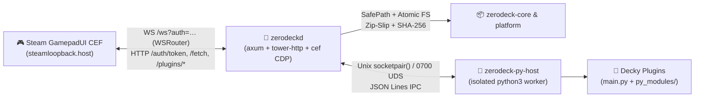

<div align="center">

# ⚡ ZeroDeck

**Performance-first, security-hardened Steam Deck plugin loader daemon written in Rust (Edition 2024) with full Decky plugin compatibility.**

[](https://github.com/ygorsimoes/zerodeck/actions/workflows/ci.yml)
[](https://github.com/ygorsimoes/zerodeck/actions/workflows/release-please.yml)
[](https://github.com/ygorsimoes/zerodeck/actions/workflows/pr-lint.yml)
[](LICENSE)
[](rust-toolchain.toml)
[](docs/architecture/wire-protocol.md)

[Architecture](#-architecture) · [Security Model](#-security--reliability) · [Quick Start](#-quick-start) · [Workspace Layout](#-workspace-layout) · [Contributing](#-contributing)

</div>

---

## 🎯 Why ZeroDeck?

**ZeroDeck** is a clean-room, MIT-licensed replacement for `decky-loader` engineered to eliminate GIL contention, PyInstaller startup overhead, unsafe filesystem primitives, and fragile IPC paths while keeping **existing Decky plugins working unmodified** (`plugin.json`, `package.json`, `ESMODULE_V1`, `LEGACY_EVAL_IIFE`, `@decky/api`, `@decky/ui`, `main.py` + `decky`/`decky_plugin`).

| Pillar | What ZeroDeck Delivers |
|---|---|
| ⚡ **Native Rust Core** | Async-native `zerodeckd` daemon built on `tokio` + `axum` + `reqwest` (`rustls`) with zero Python runtime in the core server |
| 🔒 **Security-by-Default** | Path-jail canonicalization (`SafePath`), fail-closed SHA-256 verification, Zip-Slip guards, `0755` binary permissions, and explicit `uid`/`gid` dropping |
| 🧩 **Isolated Plugin Workers** | Out-of-process `zerodeck-py-host` workers communicating via newline-delimited JSON over inherited Unix `socketpair()` FDs / `0700` runtime dirs |
| 💾 **Atomic Persistence** | Temp-file + `sync_all()` + atomic `rename()` for settings (`loader.json`) to prevent JSON corruption on power loss |
| 🎮 **Drop-In Frontend Compatibility** | TypeScript 7 + React 19 Vite bundle externalized to Steam's CEF globals (`SP_REACT`, `SP_JSX`, `SP_REACTDOM`) with `WSRouter` `FULL_SYNC` replay |
| 📜 **Clean-Room MIT** | Zero GPL code copied; dependencies audited continuously via `cargo-deny` |

---

## 🏗 Architecture



For full protocol details (`WSRouter` message types, plugin IPC frames, environment variables, and manifests), see [`docs/architecture/wire-protocol.md`](docs/architecture/wire-protocol.md).

---

## 📁 Workspace Layout

| Path | Role |
|---|---|
| [`crates/zerodeck-protocol`](crates/zerodeck-protocol) | Wire types (`WsRouter`, `PluginIpcMessage`), `plugin.json` & `package.json` schemas (zero internal crate deps) |
| [`crates/zerodeck-platform`](crates/zerodeck-platform) | OS path resolution (`UNPRIVILEGED_PATH` / `PRIVILEGED_PATH`), `SafePath` jail, `atomic_write`, privilege helpers |
| [`crates/zerodeck-core`](crates/zerodeck-core) | Atomic `SettingsManager`, plugin discovery, safe ZIP extraction, SHA-256 verification |
| [`crates/zerodeck-plugin-host`](crates/zerodeck-plugin-host) | `PluginRuntime` trait, Decky env builder, out-of-process Python host launcher & supervisor |
| [`crates/zerodeck-cef`](crates/zerodeck-cef) | Chrome DevTools Protocol client & GamepadUI tab discovery |
| [`crates/zerodeck-server`](crates/zerodeck-server) | Axum HTTP/WebSocket server, ephemeral CSRF auth, restricted CORS, `/healthz` |
| [`crates/zerodeckd`](crates/zerodeckd) | Main daemon binary (`clap` CLI, `tracing`, config validation, healthcheck, graceful shutdown) |
| [`hosts/python`](hosts/python) | `zerodeck-py-host` isolated Python worker (`>=3.10`, zero runtime deps, `ruff` + strict `pyright`) |
| [`frontend`](frontend) | `@zerodeck/frontend` (`pnpm`, TypeScript 7, React 19, Vite 8, Biome, `WSRouter` + Steam externals) |
| [`deploy/systemd`](deploy/systemd) | `zerodeck.service` systemd unit template |

---

## 🚀 Quick Start

### Prerequisites

- **Rust:** `1.100.0` (pinned in [`rust-toolchain.toml`](rust-toolchain.toml) with `rustfmt` and `clippy`)
- **Task Runner:** [`just`](https://github.com/casey/just)
- **Frontend:** `node` (`26+`) and `pnpm` (`12.16.1`)
- **Python Host:** `python3` (`>=3.10`) and [`uv`](https://docs.astral.sh/uv/) (for `ruff` and `pyright`)
- **Containers (optional):** Docker with BuildKit + Docker Compose

### Run Locally

```bash
# Install frontend dependencies (uses pnpm exclusively)
pnpm install --frozen-lockfile

# Build frontend bundle & validate config
just build-frontend
cargo run --bin zerodeckd -- --check-config

# Start the daemon (default 127.0.0.1:1337)
cargo run --bin zerodeckd -- --host 127.0.0.1 --port 1337
```

### Run via Docker Compose (Hardened)

[`compose.yaml`](compose.yaml) runs the multi-stage [`Dockerfile`](Dockerfile) runtime with `read_only: true`, `cap_drop: ["ALL"]`, `no-new-privileges:true`, `tmpfs`, and a `/healthz` check:

```bash
just docker-up
# Stop and clean up:
just docker-down
```

---

## 🧪 Verification & Quality Checks

Run the full cross-language verification suite with a single command:

```bash
just check
```

<details>
<summary>What <code>just check</code> and CI validate</summary>

| Area | Command |
|---|---|
| 🦀 **Rust fmt & clippy** | `cargo fmt --all --check` & `cargo clippy --workspace --all-targets -- -D warnings` |
| 🦀 **Rust tests** | `cargo test --workspace` |
| 🛡️ **License & advisory audit** | `cargo deny check` (enforces [`deny.toml`](deny.toml) MIT-compatible allowlist) |
| 🐍 **Python host** | `PYTHONPATH=hosts/python python3 -m unittest discover -s hosts/python/tests -v`, `ruff check`, `pyright` (strict) |
| 🎮 **Frontend** | `pnpm --dir frontend exec biome check .`, `tsc --noEmit`, `vite build`, `node --test frontend/tests/wsrouter.test.ts` |
| 🐳 **Docker parity** | `docker compose config --quiet` & `just docker-test` |

</details>

---

## 📦 Releases

Releases are fully automated with **[Release Please](https://github.com/googleapis/release-please)**:

- Merging [Conventional Commits](https://www.conventionalcommits.org/) into `main` maintains an automated **Release PR** updating versions across `Cargo.toml`, `hosts/python/pyproject.toml`, `frontend/package.json`, `Dockerfile`, and `CHANGELOG.md`.
- Merging the Release PR tags `vX.Y.Z`, publishes a formatted GitHub Release, pushes the container image to `ghcr.io/ygorsimoes/zerodeck`, and attaches `zerodeck-vX.Y.Z-linux-x86_64.tar.gz` + `SHA256SUMS.txt`.

---

## 🤝 Contributing

Contributions are welcome! Please read:

- [`CONTRIBUTING.md`](CONTRIBUTING.md) — dev setup, Conventional Commits, PR checklist, and clean-room rules
- [`AGENTS.md`](AGENTS.md) — conventions and invariants for AI coding assistants
- [`SECURITY.md`](SECURITY.md) — private vulnerability reporting and security policy
- [`CODE_OF_CONDUCT.md`](CODE_OF_CONDUCT.md) — community expectations

---

## 📄 License

Licensed under the **[MIT License](LICENSE)**.
