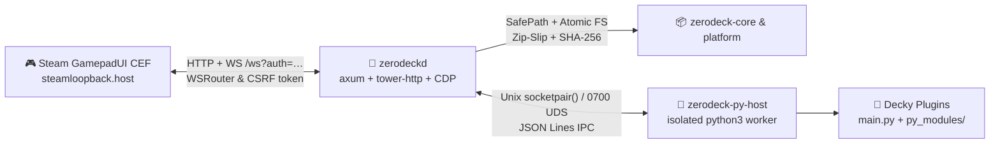

<div align="center">

<picture>
  <source media="(prefers-color-scheme: dark)" srcset="docs/assets/banner-dark.svg" />
  <source media="(prefers-color-scheme: light)" srcset="docs/assets/banner-light.svg" />
  
</picture>

<br />
<br />

[](https://github.com/ygorsimoes/zerodeck/actions/workflows/ci.yml)
[](https://github.com/ygorsimoes/zerodeck/releases)
[](https://github.com/ygorsimoes/zerodeck/actions/workflows/pr-lint.yml)
[](rust-toolchain.toml)
[](LICENSE)

<br />

*A clean-room, **MIT-licensed** Rust replacement for `decky-loader` — engineered for speed, safety, and full Decky plugin compatibility.*

<br />

[✨ Highlights](#-highlights) &nbsp;·&nbsp; [🏗️ Architecture](#️-architecture) &nbsp;·&nbsp; [🚀 Quick Start](#-quick-start) &nbsp;·&nbsp; [📦 Workspace](#-workspace) &nbsp;·&nbsp; [🚢 Releases](#-releases) &nbsp;·&nbsp; [🤝 Contributing](#-contributing)

</div>

---

> [!IMPORTANT]
> **Clean-Room & 100% Compatible:** ZeroDeck implements public Decky wire, HTTP/WebSocket, and plugin contracts (`plugin.json`, `package.json`, `ESMODULE_V1`, `LEGACY_EVAL_IIFE`, `@decky/api`, `@decky/ui`, `main.py`, and `decky` / `decky_plugin`) from scratch in Rust — **zero GPL code copied**, enforced continuously via [`cargo-deny`](deny.toml).

---

## ✨ Highlights

- ⚡ **Native Rust Core** — Async `zerodeckd` daemon built on `tokio`, `axum`, and `reqwest` (`rustls`), eliminating GIL contention and PyInstaller startup overhead on handheld hardware.
- 🔒 **Security by Default** — Path-jail canonicalization (`SafePath`), fail-closed SHA-256 verification on remote installs/binaries, Zip-Slip `enclosed_name()` guards, `0755` executable modes, and explicit `uid`/`gid` privilege dropping.
- 🧩 **Isolated Plugin Workers** — Out-of-process `zerodeck-py-host` workers running over newline-delimited JSON via inherited Unix `socketpair()` file descriptors or `0700` per-plugin directories.
- 💾 **Atomic Persistence** — Settings (`loader.json`) are written through temp-file + `sync_all()` + atomic `rename()`, preventing JSON corruption on unexpected power loss.
- 🎮 **Seamless Steam CEF Frontend** — TypeScript 7 + React 19 Vite bundle externalized to Steam's CEF globals (`SP_REACT`, `SP_JSX`, `SP_REACTDOM`) with resilient `WSRouter` `FULL_SYNC` replay.
- 📜 **Strict Supply-Chain Hygiene** — Permissive OSI-only dependency policy in [`deny.toml`](deny.toml) and `pnpm --frozen-lockfile` workspace builds.

---

## 🏗️ Architecture



📡 **Protocol Specification:** See [`docs/architecture/wire-protocol.md`](docs/architecture/wire-protocol.md) for WebSocket frame codes, plugin IPC messages, manifest schemas, and exported environment variables.

---

## 🚀 Quick Start

### 🧰 Prerequisites

| Tool | Requirement | Purpose |
|---|---|---|
| 🦀 **Rust** | `1.100.0` *(Edition 2024, via [`rust-toolchain.toml`](rust-toolchain.toml))* | Daemon & core crates (`rustfmt`, `clippy`) |
| ⚡ **`just`** | Latest | Unified workspace task runner (`just --list`) |
| 🟢 **Node.js & pnpm** | Node `26+` and **`pnpm@12.16.1`** | Frontend bundle & checks *(never use `npm`/`yarn`)* |
| 🐍 **Python & `uv`** | Python `>=3.10` + [`uv`](https://docs.astral.sh/uv/) | Isolated plugin host tests, `ruff`, strict `pyright` |
| 🐳 **Docker** *(optional)* | BuildKit + Compose | Hardened container runtime & Linux test parity |

### 💻 Run Locally

```bash
# 1. Install frontend workspace dependencies
pnpm install --frozen-lockfile

# 2. Build the frontend bundle & validate configuration
just build-frontend
cargo run --bin zerodeckd -- --check-config

# 3. Start the daemon (default 127.0.0.1:1337)
cargo run --bin zerodeckd -- --host 127.0.0.1 --port 1337
```

### 🐳 Run with Docker Compose

[`compose.yaml`](compose.yaml) runs the multi-stage [`Dockerfile`](Dockerfile) `runtime` image with `read_only: true`, `cap_drop: ["ALL"]`, `no-new-privileges:true`, `tmpfs`, and `/healthz` monitoring:

```bash
just docker-up      # Build & start zerodeckd in the background
just docker-down    # Stop & remove containers
```

<details>
<summary>⚙️ <strong>CLI Flags &amp; Environment Variables</strong></summary>

<br />

| Flag | Environment Variable | Default | Description |
|---|---|---|---|
| `--host` | `SERVER_HOST` | `127.0.0.1` | Bind address for HTTP/WebSocket server |
| `--port` | `SERVER_PORT` | `1337` | Listen port for HTTP/WebSocket server |
| `--check-config` | — | `false` | Validate paths, settings, and plugin manifests, then exit |
| `--healthcheck` | — | `false` | Probe `/healthz` on the running daemon and exit `0`/`1` |
| — | `UNPRIVILEGED_PATH` | `$HOME/homebrew` | Base directory for `settings/`, `data/`, and `logs/` |
| — | `PRIVILEGED_PATH` | `$UNPRIVILEGED_PATH` | Base directory for `plugins/` and `services/` |

</details>

---

## 📦 Workspace

| Component | Path | Responsibility |
|---|---|---|
| 📡 **Protocol** | [`crates/zerodeck-protocol`](crates/zerodeck-protocol) | Typed `WsRouter` messages, Plugin IPC frames, `plugin.json` / `package.json` schemas *(zero internal crate deps)* |
| 🧱 **Platform** | [`crates/zerodeck-platform`](crates/zerodeck-platform) | `PlatformPaths`, `SafePath` jail, `atomic_write`, privilege drop helpers |
| 📦 **Core** | [`crates/zerodeck-core`](crates/zerodeck-core) | Atomic `SettingsManager`, plugin discovery, Zip-Slip & SHA-256 verification |
| 🔌 **Plugin Host** | [`crates/zerodeck-plugin-host`](crates/zerodeck-plugin-host) | `PluginRuntime` trait, Decky env builder, Python host supervisor |
| 🌐 **CEF** | [`crates/zerodeck-cef`](crates/zerodeck-cef) | Chrome DevTools Protocol client & GamepadUI tab discovery |
| 🛡️ **Server** | [`crates/zerodeck-server`](crates/zerodeck-server) | Axum HTTP/WS server, ephemeral CSRF auth, restricted CORS, `/healthz` |
| 🚀 **Daemon** | [`crates/zerodeckd`](crates/zerodeckd) | Main CLI binary (`clap`), `tracing` telemetry, graceful shutdown |
| 🐍 **Python Worker** | [`hosts/python`](hosts/python) | `zerodeck-py-host` pure-stdlib worker (`ruff` + strict `pyright`) |
| 🎮 **Frontend** | [`frontend`](frontend) | `@zerodeck/frontend` (TypeScript 7, React 19, Vite 8, Biome) |
| 🧩 **Systemd** | [`deploy/systemd`](deploy/systemd) | Hardened `zerodeck.service` template |

### 🧪 Verification Suite

Run every Rust, Python, and Frontend check in one command:

```bash
just check
```

<details>
<summary>🔍 <strong>Individual CI &amp; Quality Gates</strong></summary>

<br />

| Area | Command |
|---|---|
| 🦀 **Rust** | `just fmt-check && just lint && just test` |
| 🛡️ **Supply Chain** | `cargo deny check` |
| 🐍 **Python** | `just py-test && uv tool run ruff check hosts/python && uv tool run pyright --project hosts/python` |
| 🎮 **Frontend** | `just fe-check` |
| 🐳 **Linux Container** | `docker compose config --quiet && just docker-test` |

</details>

---

## 🚢 Releases

Versioning and releases are automated by **[Release Please](https://github.com/googleapis/release-please)**:

1. Every PR to `main` follows [Conventional Commits](https://www.conventionalcommits.org/), enforced by [`.github/workflows/pr-lint.yml`](.github/workflows/pr-lint.yml).
2. Release Please maintains a Release PR updating [`Cargo.toml`](Cargo.toml), [`hosts/python/pyproject.toml`](hosts/python/pyproject.toml), [`frontend/package.json`](frontend/package.json), [`Dockerfile`](Dockerfile), and `CHANGELOG.md`.
3. Merging the Release PR creates tag `vX.Y.Z`, publishes formatted release notes, pushes `ghcr.io/ygorsimoes/zerodeck` container tags, and uploads `zerodeck-vX.Y.Z-linux-x86_64.tar.gz` + `SHA256SUMS.txt`.

---

## 🤝 Contributing

Contributions are always welcome! Before opening a pull request, please review:

- 📘 [`CONTRIBUTING.md`](CONTRIBUTING.md) — development setup, PR workflow, and clean-room rules
- 🤖 [`AGENTS.md`](AGENTS.md) — architectural invariants for AI coding assistants
- 🔒 [`SECURITY.md`](SECURITY.md) — private vulnerability reporting via GitHub Security Advisories
- 🤝 [`CODE_OF_CONDUCT.md`](CODE_OF_CONDUCT.md) — community guidelines

---

<div align="center">

📄 Licensed under the **[MIT License](LICENSE)** · Made with 🦀 for the Steam Deck community

</div>
