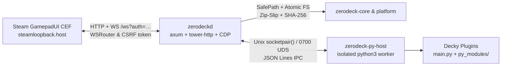

<div align="center">

<picture>
  <source media="(prefers-color-scheme: dark)" srcset="docs/assets/banner-dark.svg" />
  <source media="(prefers-color-scheme: light)" srcset="docs/assets/banner-light.svg" />
  
</picture>

<br />
<br />

[](https://github.com/ygorsimoes/zerodeck/actions/workflows/ci.yml)
[](https://github.com/ygorsimoes/zerodeck/releases)
[](https://github.com/ygorsimoes/zerodeck/actions/workflows/pr-lint.yml)
[](LICENSE)
[](rust-toolchain.toml)

<p>
  <a href="#overview">Overview</a> &nbsp;&bull;&nbsp;
  <a href="#architecture">Architecture</a> &nbsp;&bull;&nbsp;
  <a href="#quick-start">Quick Start</a> &nbsp;&bull;&nbsp;
  <a href="#workspace">Workspace</a> &nbsp;&bull;&nbsp;
  <a href="#releases">Releases</a> &nbsp;&bull;&nbsp;
  <a href="#contributing">Contributing</a>
</p>

</div>

## Overview

**ZeroDeck** is a clean-room, MIT-licensed replacement for `decky-loader` rebuilt in **Rust (Edition 2024)**. It eliminates Python GIL contention, PyInstaller startup overhead, and unsafe filesystem handling while keeping existing Decky plugins working unmodified.

> [!NOTE]
> ZeroDeck targets full protocol and runtime parity with `decky-loader` (`plugin.json`, `package.json`, `ESMODULE_V1`, `LEGACY_EVAL_IIFE`, `@decky/api`, `@decky/ui`, `main.py`, and `decky` / `decky_plugin`) without copying any GPL code.

<table>
  <tr>
    <td width="50%" valign="top">
      <h3>Native Rust Core</h3>
      Async-native <code>zerodeckd</code> daemon powered by <code>tokio</code>, <code>axum</code>, and <code>reqwest</code> (<code>rustls</code>) with zero Python runtime embedded in the core server.
    </td>
    <td width="50%" valign="top">
      <h3>Security by Default</h3>
      <code>SafePath</code> canonicalization jail, fail-closed SHA-256 verification, Zip-Slip <code>enclosed_name()</code> guards, <code>0755</code> binary modes, and explicit <code>uid</code>/<code>gid</code> privilege dropping.
    </td>
  </tr>
  <tr>
    <td width="50%" valign="top">
      <h3>Isolated Plugin Workers</h3>
      Out-of-process <code>zerodeck-py-host</code> workers communicate via newline-delimited JSON over inherited Unix <code>socketpair()</code> FDs or <code>0700</code> per-plugin directories.
    </td>
    <td width="50%" valign="top">
      <h3>Atomic Persistence</h3>
      Configuration writes (<code>loader.json</code>) use a temporary file, <code>sync_all()</code>, and atomic <code>rename()</code> so power loss never leaves truncated JSON.
    </td>
  </tr>
  <tr>
    <td width="50%" valign="top">
      <h3>Drop-In CEF Frontend</h3>
      TypeScript 7 + React 19 Vite bundle externalized to Steam globals (<code>SP_REACT</code>, <code>SP_JSX</code>, <code>SP_REACTDOM</code>) with <code>WSRouter</code> <code>FULL_SYNC</code> replay.
    </td>
    <td width="50%" valign="top">
      <h3>Clean-Room MIT</h3>
      Verified continuously in CI with <code>cargo-deny</code> (<a href="deny.toml"><code>deny.toml</code></a>) to enforce permissive OSI licenses and block copyleft dependencies.
    </td>
  </tr>
</table>

---

## Architecture



For full message schemas, WebSocket frame codes, IPC formats, and environment variables, read [`docs/architecture/wire-protocol.md`](docs/architecture/wire-protocol.md).

---

## Quick Start

### Prerequisites

- **Rust** `1.100.0` (automatically selected via [`rust-toolchain.toml`](rust-toolchain.toml))
- **[`just`](https://github.com/casey/just)** for unified workspace tasks
- **Node.js** `26+` and **`pnpm@12.16.1`** (exclusive frontend package manager)
- **Python** `>=3.10` and **[`uv`](https://docs.astral.sh/uv/)** (for `ruff` and strict `pyright`)
- **Docker** *(optional)* for hardened container builds and Linux test parity

### Run Locally

```bash
# 1. Install frontend dependencies
pnpm install --frozen-lockfile

# 2. Build the frontend bundle & validate runtime config
just build-frontend
cargo run --bin zerodeckd -- --check-config

# 3. Start the daemon (defaults to 127.0.0.1:1337)
cargo run --bin zerodeckd -- --host 127.0.0.1 --port 1337
```

<details>
<summary>CLI flags &amp; environment variables</summary>

| Flag | Environment Variable | Default | Description |
|---|---|---|---|
| `--host` | `SERVER_HOST` | `127.0.0.1` | Bind address for HTTP/WebSocket server |
| `--port` | `SERVER_PORT` | `1337` | Listen port for HTTP/WebSocket server |
| `--check-config` | — | `false` | Validate paths, settings, and plugin manifests, then exit |
| `--healthcheck` | — | `false` | Probe `/healthz` on the running daemon and exit `0`/`1` |
| — | `UNPRIVILEGED_PATH` | `$HOME/homebrew` | Base directory for `settings/`, `data/`, and `logs/` |
| — | `PRIVILEGED_PATH` | `$UNPRIVILEGED_PATH` | Base directory for `plugins/` and `services/` |

</details>

### Run with Docker Compose

[`compose.yaml`](compose.yaml) launches the multi-stage [`Dockerfile`](Dockerfile) `runtime` target with `read_only: true`, `cap_drop: ["ALL"]`, `no-new-privileges:true`, `tmpfs`, and a `/healthz` check:

```bash
just docker-up      # Build and start zerodeckd in the background
just docker-down    # Stop and remove containers
```

---

## Workspace

```text
zerodeck/
├── crates/
│   ├── zerodeck-protocol       # Wire types (WSRouter, Plugin IPC) and manifest schemas
│   ├── zerodeck-platform       # OS paths, SafePath jail, atomic FS, privilege helpers
│   ├── zerodeck-core           # SettingsManager, plugin discovery, ZIP & SHA-256 verification
│   ├── zerodeck-plugin-host    # PluginRuntime trait, env builder, Python host supervisor
│   ├── zerodeck-cef            # Chrome DevTools Protocol client & GamepadUI discovery
│   ├── zerodeck-server         # Axum HTTP/WebSocket server, CSRF auth, CORS, /healthz
│   └── zerodeckd               # Main daemon binary (CLI, tracing, graceful shutdown)
├── hosts/python                # zerodeck-py-host (pure-stdlib Python >=3.10 worker)
├── frontend                    # @zerodeck/frontend (TypeScript 7, React 19, Vite 8, Biome)
├── deploy/systemd              # zerodeck.service systemd unit template
└── docs/                       # Wire protocol specs and architecture design documents
```

### Verification Suite

Run every Rust, Python, and Frontend check in one command:

```bash
just check
```

| Check | Command |
|---|---|
| Rust format, Clippy (`-D warnings`), tests | `just fmt-check && just lint && just test` |
| License & advisory audit | `cargo deny check` |
| Python unit tests, Ruff, strict Pyright | `just py-test` / `uv tool run ruff check hosts/python` / `uv tool run pyright --project hosts/python` |
| Frontend Biome, TypeScript, Vite build, tests | `just fe-check` |
| Linux container test suite | `docker compose config --quiet && just docker-test` |

---

## Releases

Versioning and releases are automated by **[Release Please](https://github.com/googleapis/release-please)**:

1. Every PR merged to `main` uses [Conventional Commits](https://www.conventionalcommits.org/) (enforced by [`pr-lint.yml`](.github/workflows/pr-lint.yml)).
2. Release Please maintains a synchronized Release PR across [`Cargo.toml`](Cargo.toml), [`hosts/python/pyproject.toml`](hosts/python/pyproject.toml), [`frontend/package.json`](frontend/package.json), [`Dockerfile`](Dockerfile), and `CHANGELOG.md`.
3. Merging the Release PR creates tag `vX.Y.Z`, publishes formatted GitHub release notes, pushes `ghcr.io/ygorsimoes/zerodeck` container tags, and uploads `zerodeck-vX.Y.Z-linux-x86_64.tar.gz` + `SHA256SUMS.txt`.

---

## Contributing

Contributions of code, documentation, and plugin compatibility reports are warmly welcome.

- [`CONTRIBUTING.md`](CONTRIBUTING.md) — setup, PR conventions, and clean-room guidelines
- [`AGENTS.md`](AGENTS.md) — architectural invariants for AI coding assistants
- [`SECURITY.md`](SECURITY.md) — private vulnerability reporting via GitHub Security Advisories
- [`CODE_OF_CONDUCT.md`](CODE_OF_CONDUCT.md) — community standards

---

## License

Released under the **[MIT License](LICENSE)**.
